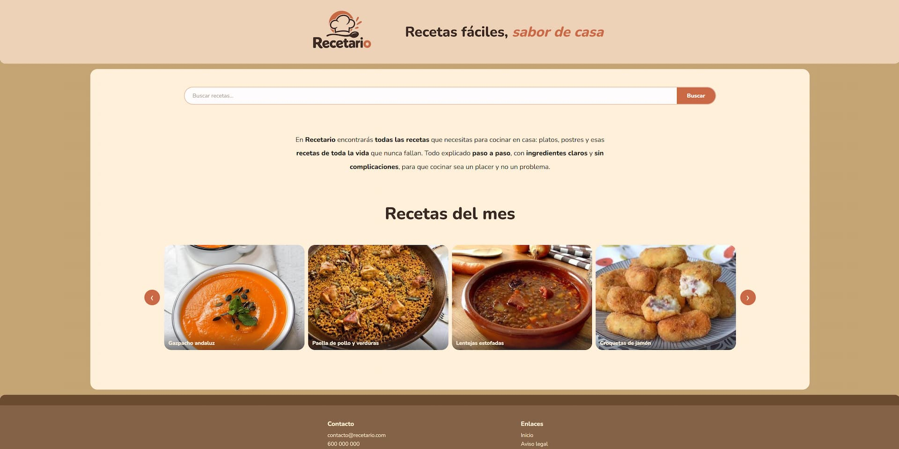
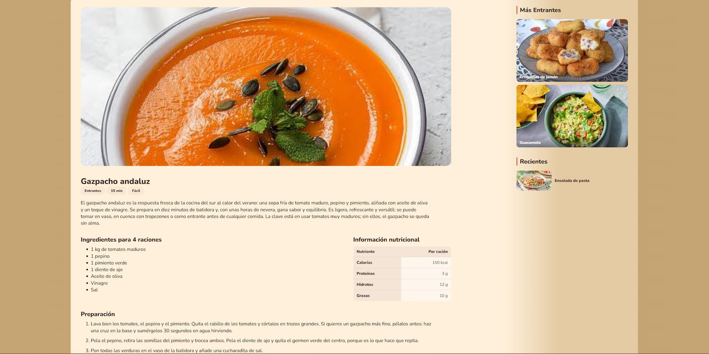
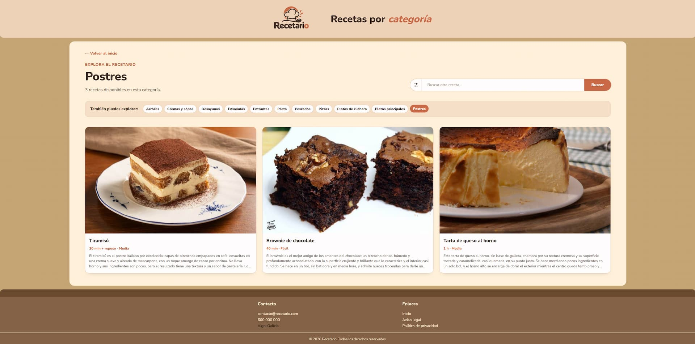

# Recetario

Web de recetas de cocina con un diseño claro, responsive y centrado en facilitar la búsqueda y consulta de platos.

<p align="center">
  
  
  
</p>

## Web publicada

Puedes visitar la versión desplegada aquí:

**[https://recetario.bascomias.workers.dev/](https://recetario.bascomias.workers.dev/)**

## Descripción

Recetario reúne recetas explicadas paso a paso, con ingredientes, información nutricional, tiempo de preparación y dificultad. La web está pensada para funcionar correctamente en ordenadores, tablets y teléfonos móviles.

## Funcionalidades

- Página de inicio con presentación del recetario y carrusel de recetas destacadas.
- Buscador de recetas por nombre, categoría e ingredientes.
- Filtros de búsqueda por:
  - Categoría.
  - Tiempo de preparación.
  - Dificultad.
- Sugerencias de recetas mientras se escribe en el buscador.
- Página individual para cada receta.
- Información de cada receta:
  - Imagen principal.
  - Categoría.
  - Tiempo.
  - Dificultad.
  - Descripción.
  - Ingredientes.
  - Información nutricional por ración.
  - Preparación paso a paso.
- Enlace desde la categoría de una receta hacia su página de recetas relacionadas.
- Página de categoría con las recetas disponibles y alternativas cuando una categoría tiene pocos resultados.
- Menú lateral con recetas relacionadas y recetas recientes en las páginas individuales.
- Diseño adaptable a diferentes tamaños de pantalla.

## Estructura del proyecto

```text
recetario/
├── index.html                    Página de inicio
├── styles.css                    Estilos generales
├── Data/
│   └── recetas.json              Datos de todas las recetas
├── Images/                       Logotipo e imágenes de recetas
├── Carousel/
│   ├── carousel.css              Estilos del carrusel
│   └── js/carousel.js            Funcionamiento del carrusel
├── Search/
│   ├── search.css                Estilos del buscador
│   └── js/search.js              Buscador, sugerencias y filtros
├── RecetaIndividual/
│   ├── recetaBlog.html           Plantilla de receta individual
│   ├── recetaBlogStyle.css       Estilos de la receta individual
│   └── js/receta.js              Carga y representación de la receta
└── Categoria/
    ├── categoria.html            Página de recetas por categoría
    ├── categoria.css             Estilos de categorías
    └── js/categoria.js           Carga y filtrado por categoría
```

## Tecnologías utilizadas

- HTML5 para la estructura de las páginas.
- CSS3 para el diseño, la paleta de colores y la adaptación responsive.
- JavaScript para el carrusel, el buscador, los filtros, las sugerencias y la carga dinámica de recetas.
- JSON como fuente de datos de las recetas.
- Google Fonts, utilizando la tipografía Nunito.

## Cómo ejecutar el proyecto

Es un proyecto estático, por lo que no necesita instalación de dependencias ni proceso de compilación.

1. Descarga o clona el proyecto.
2. Abre `index.html` en un navegador.

Para obtener una experiencia más fiel a la web publicada, también puedes abrir la carpeta con un servidor local estático.

## Navegación

- `index.html`: página principal.
- `RecetaIndividual/recetaBlog.html?id=ID_DE_LA_RECETA`: detalle de una receta.
- `Categoria/categoria.html?tipo=NOMBRE_DE_CATEGORIA`: recetas de una categoría.

Los identificadores y los datos de las recetas se encuentran en `Data/recetas.json`.

## Diseño responsive

La interfaz incluye ajustes específicos para escritorio, tablets y móviles. En pantallas pequeñas se reorganizan las columnas, se reducen tamaños y márgenes, se adapta el buscador y se ocultan los controles del carrusel que no son necesarios.

